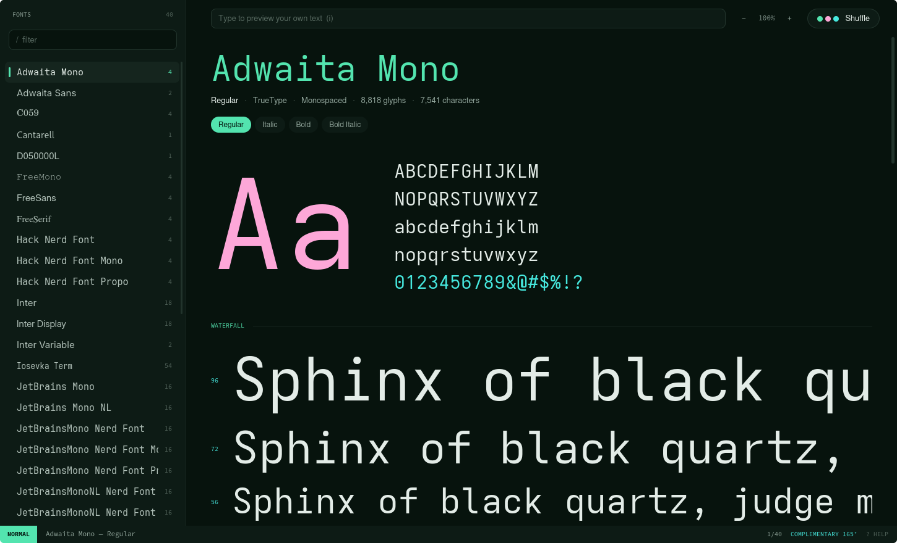
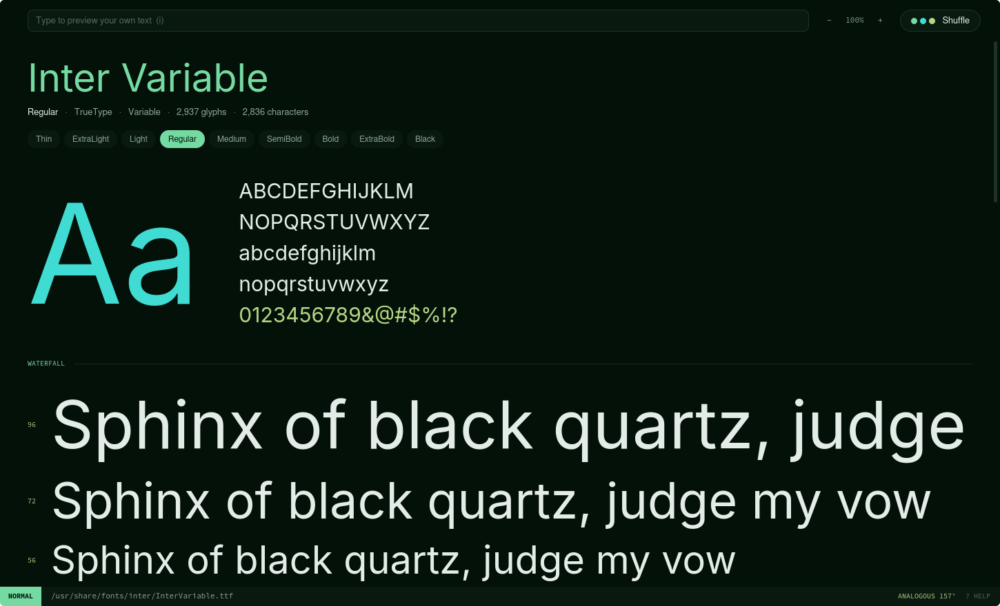
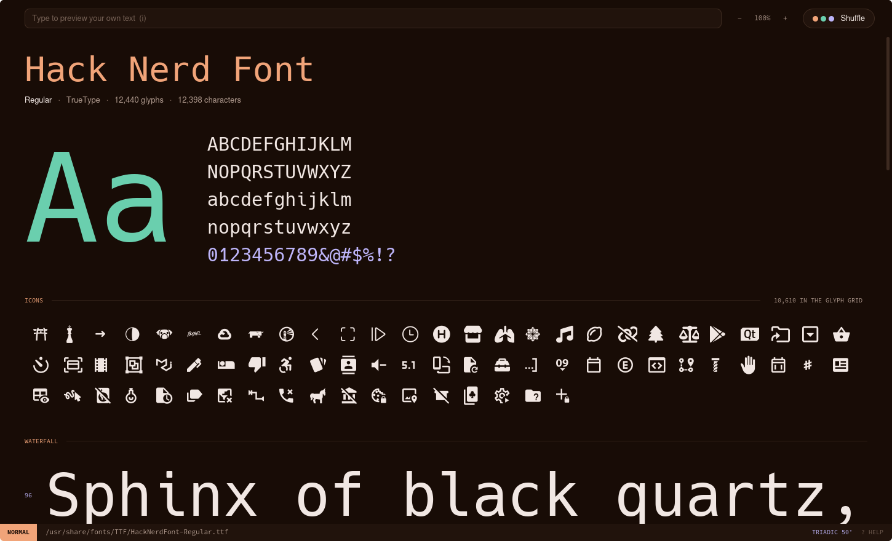

# swipeface

A keyboard-driven font viewer for Linux, written in Rust. Open a font file to
see its specimen, or run it bare to browse every installed font with vim
motions. It is always dark, and every launch (or press of **Shuffle**) rolls a
new colour scheme.



## What it does

- **Browse installed fonts.** `swipeface` lists every installed family in a
  sidebar, each name drawn in its own font, with a live specimen beside it.
- **View a font file.** `swipeface some.ttf` shows the specimen for that file
  alone. Collections (`.ttc`) list every face they contain.
- **Specimen.** A large "Aa" with the alphabet, a waterfall of sizes, running
  text, a paged glyph grid, and the font's details (designer, version, licence,
  variable axes, OpenType features).
- **Variable fonts.** Weight instances from Thin to Black are listed as styles
  and rendered by driving the `wght` axis.
- **Icon fonts.** Nerd Fonts and other icon fonts get an *Icons* section near
  the top, and the glyph grid can jump straight to any Unicode block.
- **Your own text.** Press `i` and type; the waterfall and running text use it.
- **Random dark schemes.** Colours are generated in OKLCH from a random hue and
  a colour harmony (analogous, complementary, split complementary, triadic,
  tetradic or monochrome), so the background stays dark and the accents stay
  legible whatever comes up. The current scheme is named in the status bar.

| A font file | An icon font |
| --- | --- |
|  |  |

## Install

You need a Rust toolchain recent enough for the 2024 edition (1.85 or newer).

```bash
./install.sh
```

This builds a release binary and then, for your user only:

- copies it to `~/.local/bin/swipeface`,
- adds a launcher entry at `~/.local/share/applications/swipeface.desktop`,
- makes swipeface the default application for TrueType, OpenType and font
  collection files, so opening one launches its specimen.

To remove the binary and the launcher again:

```bash
./install.sh --uninstall
```

To try it without installing:

```bash
cargo run --release
```

## Usage

```bash
swipeface              # browse installed fonts
swipeface path/to.ttf  # view one font file
```

Supported files are TrueType and OpenType fonts and collections (`.ttf`,
`.otf`, `.ttc`, `.otc`). Web fonts (WOFF, WOFF2) are not supported.

## Keys

Press `?` in the app for this list. The status bar shows the current mode.

### Browsing installed fonts

| Keys | Action |
| --- | --- |
| `j` `k` | next / previous family |
| `h` `l` | previous / next style |
| `gg` `G` | first / last family |
| `5j` `12G` | motions take counts |
| `Ctrl-d` `Ctrl-u` | half a page down / up |
| `Ctrl-f` `Ctrl-b` | a page down / up |
| `H` `M` `L` | top / middle / bottom of the list |
| `zz` `zt` `zb` | centre / top / bottom the cursor |
| `/` | filter families (`Enter` keeps the filter, `Esc` clears it) |
| `m` | monospaced families only |
| `Enter` | step into the specimen; `j` `k` `gg` `G` `Ctrl-d` `Ctrl-u` then scroll it |
| `Enter` `Esc` | step back out to the family list |
| `J` `K` | scroll the specimen without stepping in |

### Viewing a font file

| Keys | Action |
| --- | --- |
| `j` `k` | scroll down / up |
| `h` `l` | previous / next face in the file |
| `gg` `G` | top / bottom |
| `Ctrl-d` `Ctrl-u` | half a page down / up |
| `Ctrl-f` `Ctrl-b` | a page down / up |

### Everywhere

| Keys | Action |
| --- | --- |
| `[` `]` | previous / next page of glyphs |
| `{` `}` | previous / next Unicode block of glyphs (icons, arrows, …) |
| `i` | edit the sample text (`Enter` or `Esc` to finish) |
| `+` `-` `0` | zoom in / out / reset |
| `s` `Space` | shuffle the colour scheme |
| `y` | copy the family name to the clipboard |
| `?` | toggle the key list |
| `q` | quit |

Everything is also clickable: families, style pills, the Unicode block chips
above the glyph grid, the zoom controls and the Shuffle button.

## Opening fonts from a file manager

After `./install.sh`, anything that asks the desktop which application handles
a font file will get swipeface.

One caveat: `xdg-open` outside a full desktop environment (for example under
Hyprland) identifies files with the `file` command, which reports some `.ttf`
files as `application/octet-stream`, so no application is matched. Two ways
around it:

- Install `perl-file-mimeinfo` (Arch package name), which makes `xdg-open`
  use the proper file-type database.
- Or tell your file manager to match by extension. For
  [yazi](https://yazi-rs.github.io), in `~/.config/yazi/yazi.toml`:

  ```toml
  [opener]
  swipeface = [
      { run = 'swipeface %s1', orphan = true, desc = "Open in Swipeface" }
  ]

  [open]
  prepend_rules = [
      { url = "*.{ttf,otf,ttc,otc}", use = [ "swipeface", "reveal" ] }
  ]
  ```

## How it is put together

swipeface is built on [iced](https://iced.rs), whose text stack
(cosmic-text) does real shaping, so ligatures and kerning show as the font
intends.

| File | Role |
| --- | --- |
| `src/main.rs` | argument handling and window setup |
| `src/app.rs` | application state, messages and vim key handling |
| `src/view.rs` | everything on screen |
| `src/catalog.rs` | font discovery, metadata, Unicode blocks |
| `src/palette.rs` | random colour scheme generation |
| `swipeface.desktop` | launcher entry and file associations |
| `install.sh` | build, install and register |

Each face is registered with the renderer under a private alias, so the
specimen shows exactly the face you selected rather than whatever family and
weight matching would pick. Font files are memory-mapped, and a family's
details are only read when you select it.
